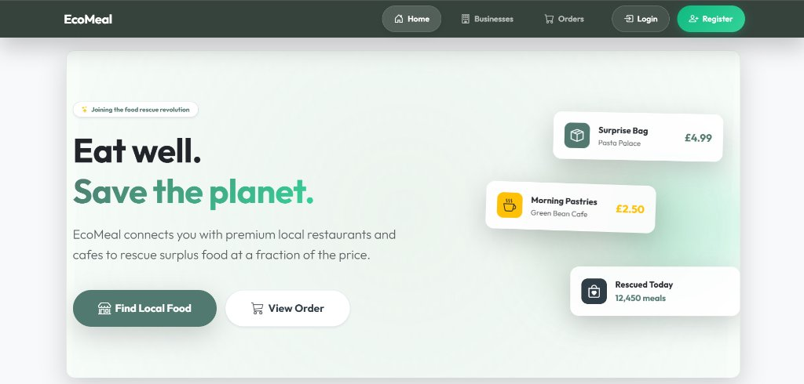
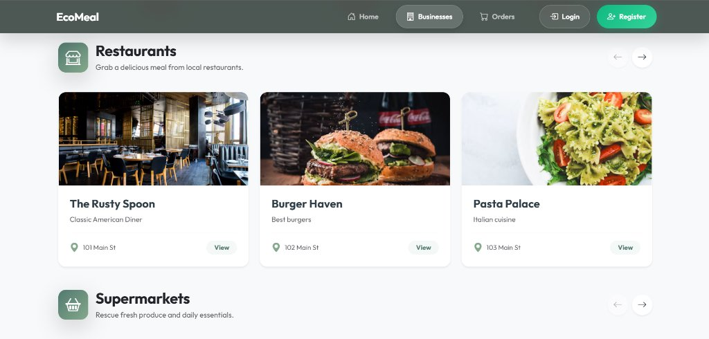
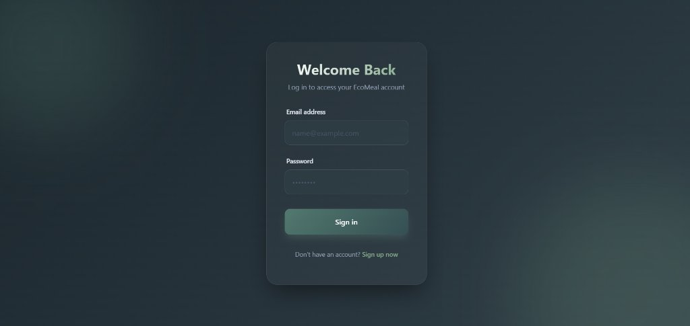

# 🌱 EcoMeal - Sustainable Dining & Food Rescue Platform

[](https://dotnet.microsoft.com/)
[](https://dotnet.microsoft.com/apps/aspnet/web-apps/blazor)
[](https://learn.microsoft.com/ef/core/)
[](https://www.microsoft.com/sql-server)
[](https://getbootstrap.com/)
[](https://www.netromsoftware.com/)

> **"Eat well. Save the planet."**  
> EcoMeal is a full-stack web application built to combat food waste. It connects conscious consumers with local restaurants, cafes, and supermarkets, enabling them to rescue delicious surplus food in the form of discounted "Surprise Bags" and flash deals.

---

## 🎓 About This Project

This project was conceived and developed as part of the **NetRom Summer Camp**

During this program, students build modern enterprise-grade applications following industry best practices, including:
* **Interactive Web Development** with modern **ASP.NET Core Blazor Server (.NET 10)**.
* **Domain-Driven & Clean Architecture** (Repository-Service pattern, dependency injection, and background workers).
* **Robust Data Modeling & Security** using **Entity Framework Core 10** and **ASP.NET Core Identity** with role-based access control.

---

## 📸 Visual Showcase

### 1. Home Page (Hero & Live Impact)
A vibrant, sustainability-inspired landing page highlighting rescued meals statistics, rapid discovery buttons, and featured surprise packages.



---

### 2. Businesses Catalog & Fire Deals
An interactive store explorer featuring category-based carousels (**Restaurants**, **Supermarkets**, **Cafes**), live search, and a curated **Fire Deals** section showcasing time-sensitive surplus offers available for immediate reservation.



---

### 3. Modern Authentication & Security
A sleek, frosted-glass (Glassmorphism) login screen powered by **ASP.NET Core Identity**, supporting role segregation for Customers, Business Managers, and System Administrators.



---

## ✨ Key Features

### 🛒 Customer Experience
* **Discover Local Partners:** Explore nearby restaurants, bakeries, and grocery stores with address previews, business categories, and custom branding.
* **Surprise Bags & Packages:** Order mystery meal boxes or specific categories (*Surprise Meal*, *Groceries*, *Pastry*, *Drinks*) at significant discounts.
* **Fire Deals:** Instant access to high-demand, limited-quantity packages ready for same-day pickup.
* **Package Reviews & Ratings:** Transparent 1-to-5 star rating system and customer feedback for individual offerings.
* **Order Tracking & History:** Manage current orders, review past pickups, and trace personal contributions toward reducing food waste.

### 🏢 Business Management (`/my-business`)
* **Store Dashboard:** Manage business profile details, contact information, category type, and storefront imagery.
* **Package Creation (`/package/create`):** Publish new surplus bags, specify pricing, define available quantity, and set pickup windows.
* **Order Fulfillment:** Real-time visibility into customer orders placed for the merchant's store.

### 🛡️ System Administration (`/admin`)
* **Admin Dashboard:** Centralized panel for managing users and verifying partner registrations.
* **Role-Based Access Control (RBAC):** Dynamically assign and modify roles (`Customer`, `BusinessManager`, `Admin`).
* **Platform Moderation:** Global control over business listings, catalog packages, and active orders.

### ⚙️ Automated Background Processing
* **`OrderCleanupService` (`BackgroundService` / `IHostedService`):** An automated background worker that periodically purges obsolete canceled and delivered orders older than 30 minutes, keeping the database optimized and query times fast.

---

## 🏛️ System Architecture & Tech Stack

The application adheres to clean separation of concerns:

```
            ┌────────────────────────────────────────┐
            │   Blazor Interactive Server UI (Razor) │
            │  (MainLayout, AuthLayout, ToastAlerts) │
            └───────────────────┬────────────────────┘
                                │
                                ▼
            ┌────────────────────────────────────────┐
            │     Controllers & Business Services    │
            │  (BusinessService, OrderService, etc.) │
            └───────────────────┬────────────────────┘
                                │
                                ▼
            ┌────────────────────────────────────────┐
            │           Repository Layer             │
            │ (IBusinessRepository, IOrderRepo, etc.)│
            └───────────────────┬────────────────────┘
                                │
                                ▼
            ┌────────────────────────────────────────┐
            │        Data Layer: EF Core 10          │
            │           (EcoMealDbContext)           │
            └───────────────────┬────────────────────┘
                                │
                                ▼
            ┌────────────────────────────────────────┐
            │         Microsoft SQL Server           │
            └────────────────────────────────────────┘
```

| Layer / Aspect | Technology & Details |
| :--- | :--- |
| **Runtime & SDK** | .NET 10.0 (C#) |
| **Web UI** | Blazor Server (`InteractiveServerRenderMode`) with Razor Components |
| **Data Access** | Entity Framework Core 10 (Code-First Migrations) |
| **Database** | Microsoft SQL Server |
| **Authentication & Auth** | ASP.NET Core Identity (GUID keys, PBKDF2 hashing, cookie authentication) |
| **Styling & Icons** | Bootstrap 5, Bootstrap Icons, Custom CSS3 Animations & Glassmorphism |
| **Notification Engine** | In-app Toast Notification Service (`IToastService`) |
| **Background Tasks** | ASP.NET Core `BackgroundService` (`OrderCleanupService`) |

---

## 📂 Project Structure

```plaintext
BlazorApp1/
├── Components/
│   ├── Layout/
│   │   ├── AuthLayout.razor          # Centered layout for login/register pages
│   │   ├── MainLayout.razor          # Primary application shell
│   │   ├── NavMenu.razor             # Responsive navbar with role-aware navigation
│   │   └── ToastContainer.razor      # Global container for interactive toast alerts
│   └── Pages/
│       ├── AdminDashboard.razor      # System user management & role administration
│       ├── Businesses.razor          # Category-sorted business listing & Fire Deals
│       ├── CreateBusiness.razor      # Form for registering a new business
│       ├── CreatePackage.razor       # Form for publishing new food packages
│       ├── Home.razor                # Landing page with hero graphics & statistics
│       ├── Login.razor               # User sign-in with glassmorphism UI
│       ├── MyBusiness.razor          # Merchant self-service management dashboard
│       ├── OrderHistory.razor        # Customer historical orders and status logs
│       ├── PackageDetails.razor      # Detailed package view, ratings & review list
│       ├── Packages.razor            # Package list per individual business
│       ├── PlaceOrder.razor          # Shopping cart review & order confirmation
│       └── Register.razor            # Customer/Merchant registration
├── Constants/
│   └── AppRoles.cs                   # Role constants: Admin, Customer, BusinessManager
├── Controllers/                      # Controller layer for endpoints & component actions
├── Data/
│   ├── EcoMealDbContext.cs           # Entity Framework DbContext with fluent relations
│   └── DbSeeder.cs                   # Automatic database seeding (roles, users, sample data)
├── Entities/                         # Domain models (Business, Package, Order, Review, etc.)
│   └── Enums.cs                      # BusinessTypeEnum, PackageTypeEnum, StatusEnum
├── Repositories/                     # Repository interfaces and SQL implementations
├── Services/                         # Core business logic & background services
│   ├── AuthService.cs                # Identity wrapper for login & registration
│   ├── BusinessService.cs           # Business CRUD & category management
│   ├── OrderCleanupService.cs        # Background worker for obsolete order cleanup
│   ├── OrderService.cs               # Order pipeline & package status updates
│   ├── PackageService.cs             # Package availability & deal management
│   ├── ReviewService.cs              # Package review aggregation & rating calculation
│   └── ToastService.cs               # Toast message dispatching service
├── screenshots/                      # Project screenshots embedded in documentation
├── wwwroot/                          # Static assets (custom CSS, Bootstrap dist, icons)
├── Program.cs                        # DI container configuration & middleware pipeline
└── appsettings.json                  # Application configuration & connection strings
```

---

## 🗃️ Database Schema & Domain Model

* **`ApplicationUser`**: Extends `IdentityUser<Guid>` with profile attributes (`FullName`) and navigation properties to orders.
* **`Business`**: Represents a partner establishment, containing name, address, category (`Restaurant`, `Supermarket`, `Cafe`), image URL, and foreign key link to the owning manager.
* **`Package`**: Food rescue packages with type tags (`SurpriseMeal`, `Groceries`, `Pastry`, `Drinks`), pricing, quantity, and associated merchant.
* **`Order` & **`OrderPackage`**: Customer order headers and itemized package selections with lifecycle states (`Pending`, `Approved`, `Delivered`, `Canceled`).
* **`Review`**: Customer ratings (1-5 stars) and textual feedback linked to specific packages.

---

## 🚀 Getting Started

### 1. Prerequisites
* [.NET 10.0 SDK](https://dotnet.microsoft.com/download/dotnet/10.0) (or compatible installed runtime).
* [Microsoft SQL Server](https://www.microsoft.com/sql-server) (LocalDB, Express, or Full edition).
* [Visual Studio 2022 / 2025](https://visualstudio.microsoft.com/) or [Visual Studio Code](https://code.visualstudio.com/) with C# Dev Kit.

### 2. Configure Database Connection
Update the connection string in `appsettings.json` to target your local SQL Server instance:

```json
{
  "ConnectionStrings": {
    "DefaultConnection": "Server=localhost\\SQLEXPRESS;Database=EcoMeal;Trusted_Connection=True;TrustServerCertificate=True;MultipleActiveResultSets=True;"
  },
  "SeedAdmin": {
    "Email": "admin@admin.com",
    "Password": "AdminPassword123!"
  }
}
```

### 3. Run Database Migrations
Open a terminal in the project directory and execute:

```bash
dotnet ef database update
```

> **Note:** On first startup, the [`DbSeeder`](file:///e:/netrom/BlazorApp1/Data/DbSeeder.cs) automatically seeds the database with the default roles, initial categories, sample partner businesses, surprise packages, and test users.

### 4. Run the Application
Launch the Blazor server application:

```bash
dotnet run
```
Or with hot reload enabled:
```bash
dotnet watch
```

Navigate to the local URL displayed in the terminal (typically `https://localhost:7xxx` or `http://localhost:5xxx`).

---

## 👥 Seeded Demo Accounts

To quickly test the various user roles without manual setup:
* **System Administrator:** Configured via `SeedAdmin` in `appsettings.json` (e.g. `admin@admin.com`).
* **Demo Users / Customers:** Seeded automatically by `DbSeeder` (e.g. `alice@example.com`, `bob@example.com` with password pattern `Name12345!`, e.g. `Alice12345!`).

---

## 💡 Acknowledgments

Special thanks to **NetRom Software** and the mentors of the **NetRom Summer Camp** for their guidance, mentorship, and support throughout the development of this project.
